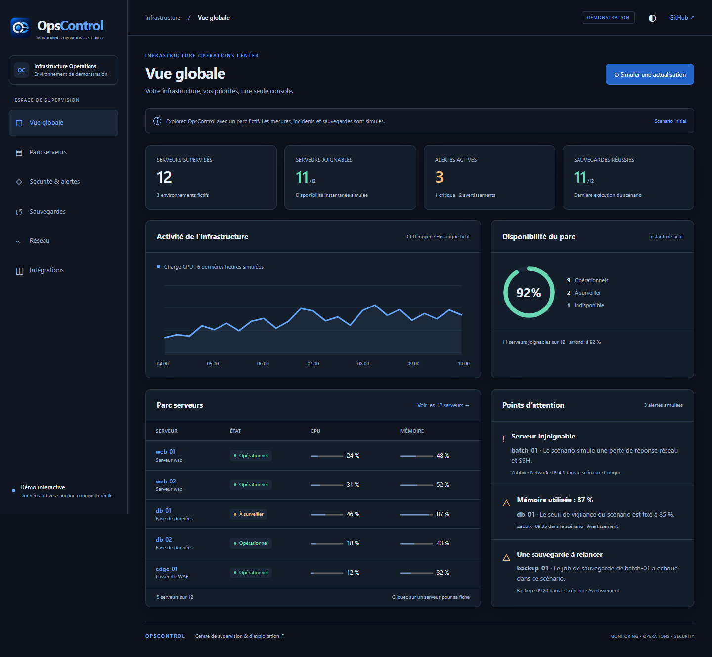

<p align="center"></p>

<h1 align="center">OpsControl v2</h1>
<p align="center">by Achraf BELASRI</p>
<p align="center"><strong>Un cockpit pour la supervision, l'exploitation et la sécurité IT.</strong><br>MONITORING · OPERATIONS · SECURITY</p>
<p align="center"><a href="https://a0707.github.io/OpsControl-v2/">Démo interactive</a> · <a href="ROADMAP.md">Roadmap</a> · <a href="docs/ARCHITECTURE.md">Architecture</a> · <a href="SECURITY.md">Sécurité</a> · <a href="CONTRIBUTING.md">Contribuer</a></p>

OpsControl réunit les informations des serveurs, hyperviseurs, outils de supervision,
sources de sécurité et sauvegardes dans une interface française. L'objectif : voir
ce qui se passe, retrouver les preuves et prioriser les interventions.

**Le parc supervisé reste en lecture seule.** Les procédures correctives sont du
texte à examiner et copier. La gestion locale des incidents et les opérations ITSM
explicitement activées sont distinctes des collectes d'infrastructure.



## Essayer sans infrastructure

La [démo publique](https://a0707.github.io/OpsControl-v2/) présente 12 serveurs fictifs,
des incidents, des métriques, des sauvegardes et des sources simulées. Les filtres,
fiches serveurs, thèmes clair/sombre et actualisations simulées fonctionnent localement.
Elle n'appelle aucune API d'exploitation et ne demande aucun identifiant.

Pour l'exécuter sur votre poste, sans dépendance :

```sh
git clone https://github.com/A0707/OpsControl-v2.git
cd OpsControl-v2
python -m http.server 8080 --bind 127.0.0.1 --directory public-demo
```

Ouvrir [http://127.0.0.1:8080](http://127.0.0.1:8080). La démo statique illustre
le produit ; ses métriques sont entièrement simulées.

## Fonctionnalités du backend

| Domaine | Fonctions présentes dans le code |
|---|---|
| Supervision | Vue du parc, disponibilité, métriques, fraîcheur des sources, SSE |
| Inventaire | Serveurs, VM et conteneurs Proxmox, stockage, applications, exports |
| Intégrations | Proxmox, Zabbix, Wazuh, Elasticsearch, Bacula, audit SSH |
| Incidents | Rapprochement des sources, chronologie, prise en charge, passation |
| Sécurité | Corrélation CVE, versions, veille, preuves et procédures textuelles |
| WAF | Observations ModSecurity, Apache, Fail2ban et états de disponibilité |
| ITSM | Connecteur GLPI facultatif, tickets et suivi explicites |
| Exploitation | Santé de l'outil, rétention, sauvegarde/restauration et packaging |

Chaque intégration exige sa propre configuration et les droits adaptés. La présence
d'un module ne garantit pas sa compatibilité avec toutes les versions d'un produit.

## Stack actuelle et limites

- Python 3.11+, FastAPI et Uvicorn.
- SQLite en mode WAL ; **un processus et un seul planificateur par base**.
- JavaScript vanilla, HTML/CSS, sans bundler ; interface française.
- Déploiement Linux documenté avec systemd, nginx et authentification déléguée.
- Tests Python, fixtures synthétiques, Playwright, Bandit, detect-secrets et Ruff.

PostgreSQL 17, Docker Compose/Swarm, Ansible et un connecteur FortiGate dédié sont
des pistes de la [roadmap](ROADMAP.md), pas des composants livrés de cette édition.
La HA du WAF observé et la HA d'OpsControl sont deux sujets distincts. Ne pas
lancer plusieurs réplicas sur une même base SQLite.

## Lancer l'application avec l'inventaire d'exemple

```sh
python -m venv .venv
# Linux / macOS
. .venv/bin/activate
python -m pip install -r requirements.txt -r requirements-dev.txt
export INFRAOPS_INVENTORY="$PWD/hosts.example.yaml"
python -m uvicorn app:app --host 127.0.0.1 --port 8001 --workers 1
```

Sous Windows PowerShell :

```powershell
python -m venv .venv
.venv/Scripts/python.exe -m pip install -r requirements.txt -r requirements-dev.txt
$env:INFRAOPS_INVENTORY = (Resolve-Path hosts.example.yaml).Path
.venv/Scripts/python.exe -m uvicorn app:app --host 127.0.0.1 --port 8001 --workers 1
```

L'inventaire contient des adresses réservées à la documentation et désactive les
collectes. Il permet de démarrer une instance isolée ; la démo statique reste le
parcours recommandé pour découvrir une interface déjà peuplée.

Le démarrage crée les fichiers locaux dans `data/`. Garder l'écoute en boucle locale
pour les essais. Avant toute exposition, lire le [guide de sécurité](docs/SECURITY.md)
et la [documentation de déploiement](deploy/README.md).

## Validation

```sh
# Linux / macOS
.venv/bin/python deploy/ci.py --offline
# Windows
.venv/Scripts/python.exe deploy/ci.py --offline
```

Le résultat attendu est `RÉSULTAT : OK`. `--offline` n'exécute pas l'audit en ligne
des dépendances. L'installation initiale des paquets nécessite Internet.
Les tests utilisent des bases temporaires et simulent les accès au parc.

Après une modification de `web/`, recalculer les versions puis ajouter les tests UI :

```sh
python deploy/assets_version.py
npm install --prefix data/browser-test playwright@1.63.0 axe-core@4.10.2
npx --prefix data/browser-test playwright install chromium
python deploy/ci.py --offline --ui
```

Sous Windows, `OPS_BROWSER_CHANNEL=msedge` permet d'utiliser Edge installé.

## Documentation

| Besoin | Document |
|---|---|
| Comprendre les flux, composants et limites | [Architecture](docs/ARCHITECTURE.md) |
| Exploiter et diagnostiquer l'application | [Runbook](docs/RUNBOOK.md) |
| Déployer sur Linux | [Déploiement](deploy/README.md) |
| Authentification, secrets, comptes de service | [Sécurité](docs/SECURITY.md), [compte de service](docs/SERVICE-ACCOUNT.md) |
| Sauvegarder et restaurer l'état local | [Restauration](docs/RESTORE.md) |
| CVE et intégration GLPI | [Sécurité CVE](docs/SECURITE-CVE.md), [GLPI](docs/GLPI.md) |
| Comprendre la préparation publique | [Publication et confidentialité](docs/PUBLICATION.md) |

## Confidentialité et partage

Cette édition fournit le code et des exemples synthétiques. Elle exclut les inventaires
d'exploitation, bases, journaux, exports, clés privées, coffres et anciens rapports internes.
Les identités et références d'environnement ont été remplacées. L'historique public
est initialisé séparément de l'historique de travail.

Les captures des utilisateurs peuvent contenir des informations sensibles : anonymiser
hôtes, domaines, IP, utilisateurs, événements et preuves avant de les joindre à une issue.
Les coordonnées de tiers dans les fixtures publiques de veille restent celles des sources.

## Contributions et conditions de réutilisation

Les propositions passent par une issue ou une pull request, avec un scénario synthétique
et la validation adaptée. Voir [CONTRIBUTING.md](CONTRIBUTING.md).
Aucune licence open source n'est accordée à ce stade. Consulter [NOTICE.md](NOTICE.md)
avant de redistribuer ou réutiliser le code.
