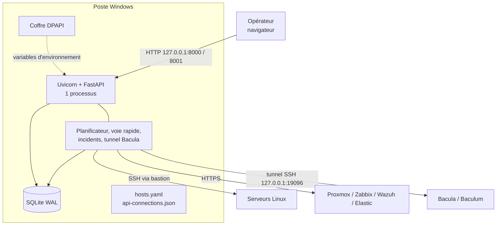
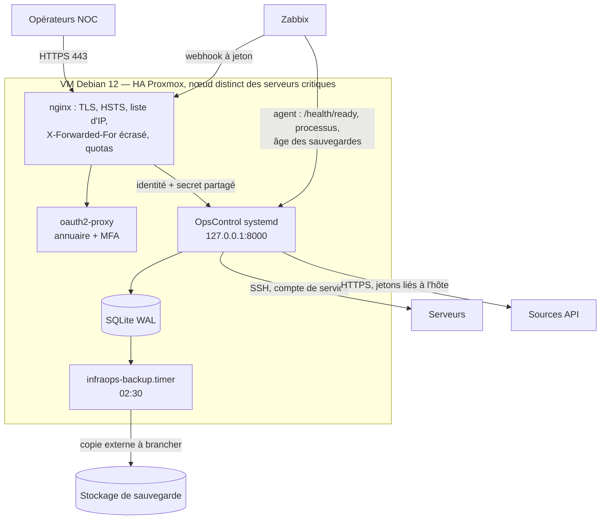

# Architecture d'OpsControl

OpsControl (anciennement InfraOps) est un centre de supervision **en lecture seule** :
il audite les serveurs configurés par SSH, agrège Proxmox, Zabbix, Wazuh, Elasticsearch et
Bacula, et présente l'ensemble à l'équipe Infra / NOC. Aucune route ne modifie un serveur
supervisé ; les commandes correctives sont du texte à copier.

## Composants

| Composant | Technologie | Rôle |
|---|---|---|
| API et interface | FastAPI + Uvicorn, **un seul processus** (`--workers 1`) | Routes `/api/*`, fichiers statiques `web/`, flux SSE `/api/events` |
| Politique d'accès | `access_policy.py`, `operator_identity.py` | Rôles viewer / operator / admin, CSRF, quotas, audit des mutations, en-têtes de sécurité |
| Planificateur et collectes | `jobs.py` (fil de fond démarré par `app.py`) | Audits SSH et sondes réseau en tâche de fond, sources API, inventaire batch, voie rapide (`tier0.py`), rétention ; sans état propre, lit celui d'`app` |
| Schéma | `migrations.py` (versionné) + migrations propres à `access_policy` et `incident_center` | Tables du cœur et des modules ; aucune création de table dans une route GET |
| Collecte SSH | `ssh.py`, `collector.py`, `audit_engine.py` | Commandes en liste fermée (`ssh.OPERATIONS`), OpenSSH ou Paramiko, `StrictHostKeyChecking=yes` |
| Sources API | `management.py` | HTTPS vérifié, sans redirection, réponses bornées ; jetons liés à leur hôte (`data/token-bindings.json`) |
| Sécurité & CVE | `security_cve.py`, `security_feeds.py`, `security_versions.py`, `security_remediation.py` | Paquets relevés en SSH (opération figée), Wazuh, veille publique HTTPS, corrélation dpkg/rpm, procédures texte, tickets via ITSM ([SECURITE-CVE.md](SECURITE-CVE.md)) |
| Stockage | SQLite en WAL (`data/state.sqlite3`), `hosts.yaml`, `data/api-connections.json` | État, historique, incidents, audit des mutations |
| Secrets | coffre DPAPI (poste Windows) ou `/etc/infraops/secrets.env` (VM) | Variables d'environnement du processus uniquement |
| Journaux | `logging_setup.py` (JSON, request_id), `audit.log` (appels SSH) | stderr → journald sur la VM |

L'état des tâches, les verrous et le planificateur vivent **en mémoire** : un seul processus
par base (verrou `<base>.lock`). C'est la raison du `--workers 1` et de l'absence de mise à
l'échelle horizontale, choix assumé pour ce volume (voir « Évolutions »).

## Architecture actuelle (poste Windows)

## Architecture cible (VM)

## Flux et ports

| Flux | Protocole / port | Remarque |
|---|---|---|
| Navigateur → nginx | HTTPS 443 (80 redirigé) | Liste d'IP d'exploitation |
| nginx → OpsControl | HTTP 127.0.0.1:8000 | Seul point d'entrée |
| nginx → oauth2-proxy | HTTP 127.0.0.1:4180 | `auth_request` |
| Zabbix → OpsControl | HTTPS `/api/webhooks/zabbix` | IP Zabbix seule + jeton ≥ 32 caractères |
| OpsControl → serveurs | SSH 22 | Commandes de lecture en liste fermée |
| OpsControl → API | HTTPS (ports des produits) | TLS vérifié, pas de redirection |
| OpsControl → Bacula | tunnel SSH local 19096 → 9096 | Seule exception HTTP, en boucle locale |
| Agent Zabbix → OpsControl | HTTP 127.0.0.1:8000 `/health/ready` | Lecture locale, sans proxy |

## Points de défaillance uniques

| Composant | Mitigation actuelle | Cible |
|---|---|---|
| Hôte (PC ou VM) | aucune sur le PC | VM en HA Proxmox |
| Processus | `Restart=always` (VM) | + alerte Zabbix (modèle OpsControl) |
| Base SQLite | sauvegarde quotidienne, avant chaque bascule | + copie externe, test de restauration mensuel |
| Accès (nginx, oauth2-proxy) | même VM | accès de secours par tunnel SSH (RUNBOOK) |
| Supervision de l'outil | modèle `deploy/zabbix-template-opscontrol.yaml` | importé et lié à la VM |

## Évolutions écartées, et pourquoi

- **Kubernetes, Docker** : une seule application, un seul processus, déjà durci par systemd.
  Ils ajouteraient une plateforme à exploiter sans résoudre de besoin observé.
- **Actif/actif** : demanderait de sortir l'état de la mémoire (base partagée, file de
  messages) et de refondre le planificateur. Non justifié pour le périmètre actuel ;
  la HA Proxmox de la VM couvre la panne d'un nœud.
- **Prometheus / Grafana** : Zabbix est déjà en place et intégré ; `/api/metrics` existe
  pour le jour où un collecteur Prometheus serait réellement utilisé.
