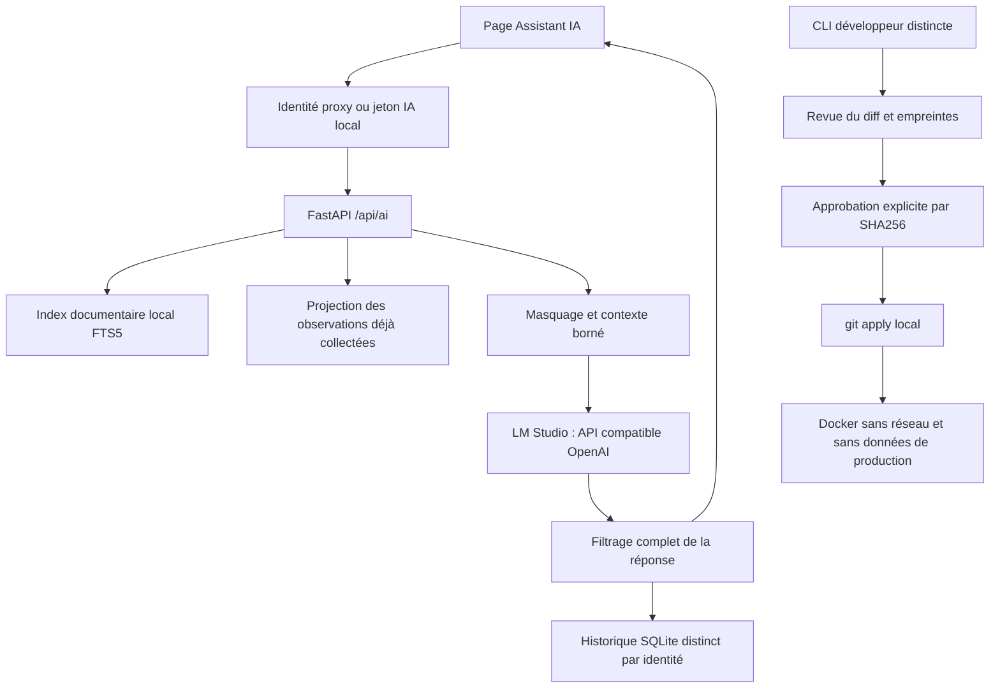

# Assistant IA local OpsControl

## Architecture et périmètre

L'intégration conserve FastAPI et JavaScript vanilla. `ai_service.install` ajoute
les routes avant le montage statique. `access_policy` conserve les rôles, le CSRF,
les quotas et l'audit des requêtes. Aucun runner SSH, API de mutation distante,
outil SQL ou interpréteur shell n'est offert au modèle.



Modules : `ai_llm.py` (transport), `ai_security.py` (frontière de confiance),
`ai_rag.py` (index), `ai_service.py` (API/historique), `ai_developer.py` (CLI),
`web/ai.js` et `web/ai.css` (interface).

## Installation et LM Studio

Utiliser le venv existant. Aucun nouveau package Python n'est requis pour l'IA :
le transport utilise la bibliothèque standard et SQLite fournit FTS5.
Sur une installation neuve : Python 3.11+, Git, `pip install -r requirements.txt`
et `pip install -r requirements-dev.txt` pour la validation.

Dans LM Studio, vérifier les modèles et le port effectif, sans supposer 1234 :

```text
lms ls --json
lms ps --json
lms server status --json
```

L'inventaire CLI peut réveiller LM Studio. Aucun téléchargement automatique
n'est réalisé par OpsControl. L'inventaire `/v1/models` ne prouve pas à lui seul
qu'un modèle est chargé : vérifier `lms ps`, puis une génération.

Dans les réglages serveur : écoute `127.0.0.1`, CORS désactivé,
journalisation des données sensibles désactivée, logs verbeux désactivés.
Après une modification, vérifier la configuration effective. Sur le poste inspecté,
le serveur a été redémarré localement pour appliquer ces réglages.

Pour évaluer le modèle déjà présent, sans téléchargement :

```text
lms load qwen2.5-coder-3b-instruct --context-length 2048 --gpu off --estimate-only
lms load qwen2.5-coder-3b-instruct --context-length 2048 --gpu off --parallel 1 --ttl 180 --identifier opscontrol-local --yes
lms server start --bind 127.0.0.1 --port 1234
```

Remplacer le port par celui vérifié. Le TTL décharge le modèle après inactivité :
le recharger au besoin. Éviter le chargement JIT à contexte élevé sur ce poste.
Un contexte de 2048 est le réglage d'évaluation initial, pas une garantie pour de
longues analyses. Les entrées sont volontairement bornées et les extraits courts.

## Choix du modèle sur le poste inspecté

Windows 11 Pro 64 bits, i5-10210U (4 cœurs / 8 threads), RAM 15,8 Gio,
Intel UHD intégré, pilote 31.0.101.2140. Le champ Windows AdapterRAM rapporte
1 Gio : ce n'est pas une mesure de VRAM dédiée utilisable par un LLM.
La RAM libre a varié d'environ 0,7 à 1,7 Gio pendant le diagnostic.
D: possède environ 355 Gio libres ; C: environ 4 Gio seulement.

| Modèle | État | Ressources et usage | Licence / décision |
|---|---|---|---|
| Qwen2.5-Coder-3B-Instruct Q4_K_M | Présent, 2 104 932 800 octets | LM Studio estime 2,09 Gio à contexte 2048 et CPU ; chargé en 31,09 s | Qwen Research : évaluation/recherche ; usage commercial soumis à licence supplémentaire |
| Nomic Embed Text v1.5 Q4_K_M | Recensé par LM Studio, 84 106 624 octets | Modèle d'embeddings, contexte recensé 2048 | Inutilisé : FTS5 évite une dépendance et une charge supplémentaires |
| Qwen2.5-Coder-1.5B-Instruct Q4 | Non téléchargé | Candidat léger pour cette machine ; qualité à comparer sur les cas OpsControl | Apache 2.0 sur la fiche officielle ; téléchargement soumis à accord |
| Qwen2.5-Coder-7B-Instruct Q4 | Non téléchargé | Candidat code plus capacitaire, mais RAM actuellement insuffisante pour le choisir sereinement | Apache 2.0 sur la fiche officielle ; mesures et accord nécessaires |

Les fenêtres théoriques des fiches modèles ne sont pas les contextes chargés.
Le 3B est recensé à 32768 tokens mais chargé à 2048 pour limiter la mémoire.
LM Studio indique `trainedForToolUse=false` pour ce modèle ; aucune capacité
d'appel d'outils n'est donc utilisée. Aucun modèle secondaire n'est nécessaire.
La qualité en français, le raisonnement et la fiabilité des patchs exigent une
évaluation métier plus large qu'une réponse de validation.

Sources officielles consultées le 08/10/2026 :
- https://lmstudio.ai/docs/developer
- https://lmstudio.ai/docs/cli/serve/server-status
- https://huggingface.co/Qwen/Qwen2.5-Coder-3B-Instruct/blob/main/LICENSE
- https://huggingface.co/Qwen/Qwen2.5-Coder-1.5B-Instruct
- https://huggingface.co/Qwen/Qwen2.5-Coder-7B-Instruct

## Configuration

| Variable | Valeur par défaut | Fonction |
|---|---|---|
| `OPSCONTROL_AI_ENABLED` | `0` | Activation explicite de l'API IA |
| `OPSCONTROL_AI_URL` | `http://127.0.0.1:1234/v1` | URL vérifiée, port explicite et IP littérale |
| `OPSCONTROL_AI_MODEL` | `opscontrol-local` | Identifiant renvoyé par `/v1/models` ; utiliser `opscontrol-local` avec le chargement ci-dessus |
| `OPSCONTROL_AI_TIMEOUT` | `180` | Timeout de transport, borné entre 1 et 180 secondes ; adapté à la latence CPU mesurée |
| `OPSCONTROL_AI_API_KEY` | vide | Jeton serveur LM Studio si son authentification est activée |
| `OPSCONTROL_AI_ALLOWED_IPS` | vide | IP distante explicitement autorisée ; HTTPS obligatoire hors loopback |
| `OPSCONTROL_AI_LOCAL_TOKEN` | vide | Secret distinct, au moins 32 caractères, pour la session locale |
| `OPSCONTROL_AI_CODE_READ` | `0` | Lecture de code uniquement pour admin, sans droit d'écriture |
| `OPSCONTROL_AI_DATA` | `data/ai` | Index et historique séparés de `COCKPIT_DB` |
| `OPSCONTROL_AI_DEV_ENABLED` | `0` | Activation de la CLI développeur, jamais de route web d'application |
| `OPSCONTROL_AI_DEV_TOKEN` | vide | Secret développeur distinct d'au moins 32 caractères, saisi à chaque invocation |
| `OPSCONTROL_AI_TEST_IMAGE` | `opscontrol-ai-tests:local` | Image Docker locale de tests, jamais téléchargée implicitement |

Ne pas stocker de secret dans Git, un diff, un exemple ou une commande partagée.
`data/` est déjà ignoré. Restreindre l'accès OS à `data/ai` au compte du service
(0700 pour le dossier sous Linux, droits de fichier adaptés via umask 077).
L'historique n'est pas chiffré : protéger aussi les sauvegardes et le poste.

## Démarrage local

Après le chargement LM Studio, ouvrir PowerShell 7 depuis le dépôt :

```powershell
./LANCER-IA-LOCAL.ps1 -Model opscontrol-local -LlmUrl http://127.0.0.1:1234/v1
```

Le lanceur génère un jeton IA local pour le processus et l'affiche uniquement
dans votre console. Saisir ce jeton dans la page **Assistant IA**, puis
**Vérifier la connexion**. Le jeton reste en mémoire du navigateur ; il n'est
pas conservé dans localStorage. Le mode patch reste désactivé.
Le lanceur démarre l'application normale, avec son inventaire et ses collectes
existants. Il ne remplace pas leurs réglages. Pour un essai sans parc, utiliser
un inventaire de démonstration, une base dédiée et désactiver la synchronisation
des incidents avant l'import d'app ; ne pas démarrer le service d'exploitation
comme serveur de test.

Si un secret de reverse proxy est configuré, les règles existantes de refus
d'accès direct restent applicables. Ne pas les désactiver pour faire fonctionner
l'IA : utiliser le proxy authentifié, ou le mode local explicitement prévu
par `INFRAOPS_LOCAL_ROLE` après décision d'exploitation.

Sur Linux/systemd : configurer ces variables dans un EnvironmentFile protégé du
service existant. Le navigateur appelle OpsControl ; seul le backend contacte LM
Studio. Si LM Studio tourne sur Windows et OpsControl sur Linux, le loopback est
celui de chaque machine : prévoir un tunnel privé ou un endpoint HTTPS sur une
IP explicitement autorisée. Aucun port public ne doit être ouvert pour l'IA.
Le proxy SSE doit désactiver le buffering et permettre un délai supérieur au
timeout LLM. Utiliser le déploiement existant à processus unique : le quota de
génération est en mémoire, pas distribué entre workers.

## Utilisation et autorisations

Viewer/operator/admin authentifiés peuvent demander une synthèse en modes
supervision, incidents et sécurité. L'IA reçoit seulement une projection des
observations déjà collectées pour la clé de serveur demandée. Elle ne déclenche
aucune collecte, n'accepte aucune empreinte SSH et ne modifie aucun serveur.
Les extraits de logs peuvent être fournis dans **Observations ou logs filtrés**.
Zabbix, Wazuh, WAF, Proxmox, Elastic et Bacula sont analysables à partir des
preuves fournies, sans connecteur IA disposant d'un accès supplémentaire au parc.
La clé de connexion API facultative joint la synthèse et les indicateurs déjà
stockés via la vue publique compacte des connexions (URL et variables de secrets
exclues), sans rafraîchissement. Les événements détaillés peuvent être fournis
dans les observations après filtrage.

Exemples : « Quels faits manquent pour confirmer la cause de cette alerte ? »,
« Explique SQLite WAL dans OpsControl et cite la documentation »,
« Compare ces événements WAF et relève les faux positifs possibles »,
« Explique cette fonction et propose un diff minimal » en mode développement.

La lecture de code requiert admin ET `OPSCONTROL_AI_CODE_READ=1`. Cela n'accorde
aucun droit de modification. Le retrait de ce droit masque aussi l'historique
des conversations en mode développement. L'identité propriétaire est vérifiée
pour l'historique ; un identifiant de conversation ne donne pas accès à autrui.
100 tours maximum par identité, expiration à 30 jours à la prochaine écriture,
40 derniers tours exposés ; suppression volontaire possible dans la page.

## Recherche documentaire et contexte

L'index SQLite FTS5 utilise `git ls-files` (suivis et nouveaux non ignorés),
une liste de types/chemins autorisés, les métadonnées et SHA256 des contenus.
README, AGENTS, docs et sources Python/JS pertinentes sont découpés avec lignes
d'origine. Tests, inventaires, données, logs, secrets, copies de release et graphes
générés restent exclus. Les liens symboliques, chemins sortant du dépôt et gros
fichiers sont refusés. Les contenus indexés sont filtrés avant stockage.
Les fichiers modifiés seuls sont réindexés ; la vérification est espacée de
10 secondes minimum. Une suppression retire ses fragments. La recherche
viewer porte sur la documentation ; le code reste soumis à son droit distinct.

Les sources retournées sont des extraits effectivement joints à la requête,
pas une preuve que chaque affirmation du modèle est correcte. Cliquer sur une
référence pour lire les lignes autorisées. Le contexte n'est pas l'ensemble du
dépôt : trois extraits courts, observations bornées et dernier échange conservé.
FTS5 suffit à cette première version ; pas de base vectorielle externe, pas de
réindexation intégrale à chaque question, pas d'embeddings requis.

## Sécurité et limites explicites

- 16 Kio maximum par corps HTTP IA, entrées Pydantic strictes, champs bornés ;
  contexte maximal 7000 octets et génération maximale 512 tokens.
- Six demandes de chat par minute et identité via la politique existante ; une
  seule génération LLM concurrente par processus, refus 429 si occupée.
- Authentification IA supplémentaire au mode local historique, CSRF existant,
  aucune redirection HTTP ou utilisation implicite d'un proxy d'environnement.
- Masquage des motifs de secrets et valeurs sensibles de l'environnement avant
  transmission, indexation et historique, puis filtrage complet des réponses.
  Ce filtre ne reconnaît pas toute donnée confidentielle possible : ne fournir
  que les données autorisées et filtrer les logs opérationnels à la source.
- Sources et logs délimités comme non fiables dans les instructions système.
  L'injection de prompt peut encore influencer le texte ; les interdictions
  d'exécution sont imposées par l'absence d'outil/backend mutateur, pas par une
  promesse du modèle. Les sorties HTML sont rendues avec textContent.
- Le flux LM Studio est consommé en SSE et validé, mais la réponse navigateur
  apparaît après filtrage complet : pas d'affichage token par token non filtré.
  Interrompre ferme le flux ; le worker observe l'annulation au prochain retour
  LM Studio ou expire au timeout. L'interruption n'est pas un arrêt forcé du modèle.
- La base d'exploitation n'est jamais transmise au modèle. L'API lit les vues
  applicatives existantes, sans donner d'accès SQL. Historique et index distincts.
- La configuration de l'API ne peut pas certifier le binding réseau ou les logs
  d'une installation LM Studio distante : les vérifier côté serveur également.

## Workflow développeur

Depuis un terminal local, définir les deux variables développeur ; conserver
le secret hors Git et le saisir à l'invite. Admin web ne suffit jamais.

```text
python ai_developer.py ask --question "Explique ce bug et propose un diff Git"
python ai_developer.py review --patch correction.diff --record revue.json
python ai_developer.py apply --record revue.json --approve EMPREINTE_AFFICHEE
python ai_developer.py test
```

La CLI demande le jeton distinct pour chaque commande. `review` présente le diff,
vérifie `git apply --check`, mémorise les empreintes des fichiers et délivre un
SHA256 d'approbation. `apply` exige cette empreinte exacte et refuse si le diff,
le manifeste, la racine ou les fichiers ont changé. Seules des modifications
textuelles de fichiers existants sont acceptées ; liens, traversées, binaires,
renommages, fichiers sensibles et déploiement sont exclus.

Avant toute écriture, Docker et l'image locale doivent être prêts. Ensuite le
patch est appliqué localement et les tests sont exécutés dans une copie temporaire
du code, sans inventaire/data/secrets d'exploitation ni variables de connexion.
Le conteneur a réseau désactivé, source en lecture seule, utilisateur non root,
capabilities supprimées, limites CPU/RAM/processus, aucun socket Docker monté.
La recette `deploy/ai-tests.Dockerfile` prépare cette image. Une construction
explicite depuis la racine (`docker build -f deploy/ai-tests.Dockerfile -t opscontrol-ai-tests:local .`)
télécharge une base Python et des paquets : elle n'a pas été lancée et nécessite
l'accord de l'exploitant.
L'image doit être une image de confiance avec Python et les dépendances/tests
OpsControl préinstallés. Sa préparation nécessite une opération explicite hors
de la CLI ; aucun build, pull ou installation n'est déclenché par une réponse LLM.
Sur ce poste, Docker n'est pas trouvé : application et tests isolés indisponibles.
Les règles de manifeste et l'isolation sont testées avec mocks ; une exécution
réelle du conteneur reste à valider lorsque Docker sera disponible.

Un test échoué après application est signalé. Aucun commit, reset ou rollback
automatique ne supprime vos modifications. Examiner le diff, corriger ou inverser
uniquement le patch approuvé après nouvelle vérification humaine.

## Validation et dépannage

```text
python -m unittest test_ai -v
python deploy/ci.py --offline
node test_ui_ai.cjs
```

Le test navigateur intercepte toutes les API. Chrome installé peut être utilisé
avec `OPS_BROWSER_CHANNEL=chrome` ; aucun navigateur n'est téléchargé implicitement.
Les tests Python utilisent `testing_env` et mocks externes ; aucun serveur de
production n'est contacté. Le test manuel LM Studio réel doit rester séparé de CI.

| Symptôme | Vérification |
|---|---|
| 503 assistant désactivé | Activation `OPSCONTROL_AI_ENABLED` puis redémarrage du backend |
| 401 identité refusée | Identité proxy ou jeton local ; jeton loopback, sans X-Forwarded-For |
| 403 mode développement | Rôle admin et activation de lecture du code ; patch toujours CLI |
| LM Studio indisponible | `lms server status --json`, binding, port effectif, URL backend |
| 404 modèle absent | `lms ps`, `/v1/models`, identifiant exact et rechargement après TTL |
| 504 timeout | Charge CPU/RAM, prompt plus court ; limite maximum 180 secondes |
| 429 occupé/quota | Attendre la fin du worker ou la fenêtre de quota |
| Réponse vide/502 | Modèle et compatibilité API, flux incomplet ou appel d'outil refusé |
| Source manquante | Fichier autorisé non ignoré par Git, attendre 10 s, mots-clés pertinents |
| Docker absent | CLI refuse d'appliquer ; préparer l'environnement isolé avant nouvel accord |

## Maintenance, désactivation et retour arrière

Une mise à jour de modèle se fait explicitement dans LM Studio, après estimation
RAM et vérification de licence. Changer l'identifiant dans l'environnement,
redémarrer OpsControl puis valider des cas anonymisés en français. Les tests
unitaires mockés ne mesurent pas la qualité d'un nouveau modèle.

Désactiver `OPSCONTROL_AI_ENABLED=0` et redémarrer ferme tous les endpoints IA.
Conserver `OPSCONTROL_AI_DEV_ENABLED=0` dans le service de supervision.
L'application existante continue de fonctionner. Supprimer l'historique depuis
la page avant désactivation si nécessaire ; gérer ensuite le dossier data/ai
selon la politique de conservation. Aucun nettoyage automatique destructif.

Pour retirer le code, sauvegarder le diff courant, retirer uniquement l'import
`ai_service` et son installation dans app.py, les deux règles POST IA et le quota
IA, puis les références ai.js/ai.css dans index.html. Relancer assets_version.py
et la CI offline. Conserver les sauvegardes de code hors du dépôt public.

## Acceptation

Les résultats mesurés et les critères restant ouverts sont consignés dans
`docs/ASSISTANT-IA-VALIDATION.md`. L'intégration n'est pas déclarée entièrement
terminée tant que le modèle d'exploitation/licence et le mode développeur isolé
ne sont pas validés. Aucun changement d'infrastructure distante n'est prévu.
